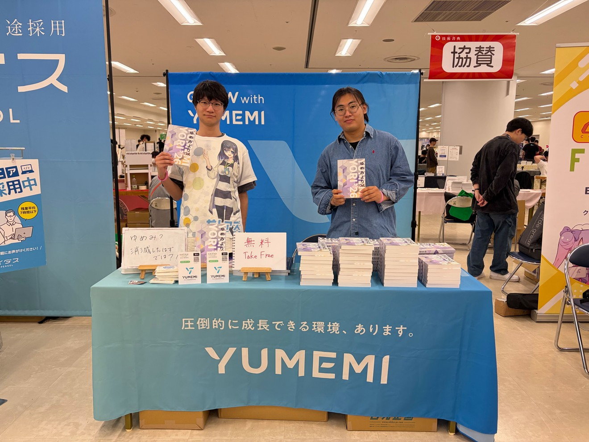
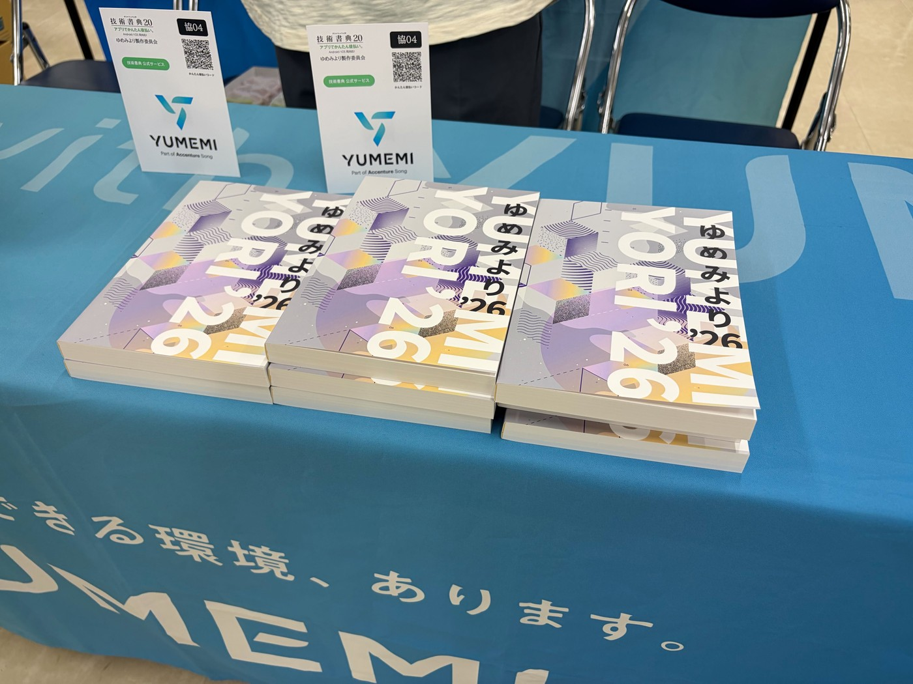
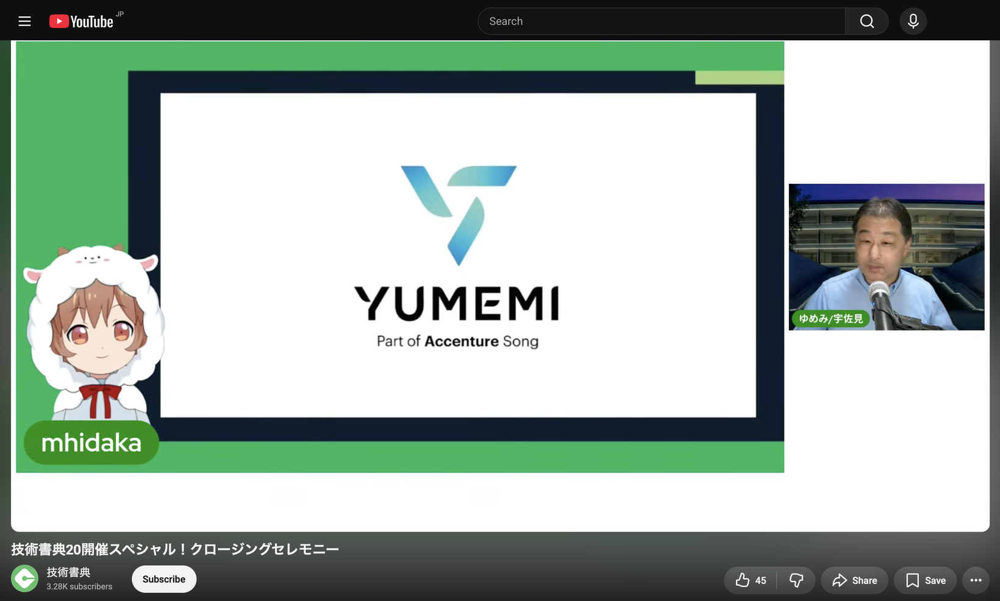

# ゆめみ執筆委員会の紹介

ゆめみ執筆委員会は、ゆめみブランド向上のため、書籍執筆（技術同人誌および商業出版）を推進する委員会です。とくに、自分たちの意志で本を発行できる技術同人誌の形での本の製作に力を入れています。

## ゆめみより製作委員会

ゆめみより製作委員会は、ゆめみの有志メンバーによる技術同人誌サークルです。現在、次回作である「ゆめみより '26（2）」の製作を進めています。「ゆめみより」は、複数の著者によるアンソロジー本です。章ごとに異なる著者が独立した内容を書いています。内容についてのテーマ設定はおこなわず、各著者が好きなことを書いてよいことにしています。

なお 2025 年までは「ゆめみ大技林」という名前で製作していました。ゆめみがアクセンチュアにジョインした後の 2026 年から「ゆめみより」と改題して製作活動を継続しています。

## これまでに製作した本

製作した本は、各種イベントにて無償で頒布しています。また、電子版は BOOTH で無償でダウンロードできます（BOOTH はピクシブ株式会社が運営する、創作物が集まるマーケットプレイスです）。ぜひご覧ください。

BOOTH : <https://yumemi-inc.booth.pm/>

<section class="book">
    

        

            
        

        

            <h3>ゆめみより '26</h3>
            
現在の最新刊で、シリーズ通算 8 冊目です。「ゼロからわかる Solana NFT 開発」「AI 映画祭で優勝の、AI 映画の作り方」「おお我らが二値の Bool を Optional で三値するな高校」「Web エンジニアのための SecOps 超入門」「PacketLogger を使って BLE 通信の中身を覗いてみる」など 18 本の記事を収録しています。

        

    

</section>

<section class="book">
    

        

            
        

        

            <h3>ゆめみ大技林 '25 (2)</h3>
            
ひとつ前の刊で、シリーズ 7 冊目です。「React エンジニア向け Flutter 入門」「PHP で始める振る舞い駆動開発」「止められないシステムを守れ！ OT セキュリティ入門」「エンジニアにこそ広まってほしい自作キーボードの世界」などの記事があります。

        

    

</section>

<section class="book-gallery">
    

        
        
ゆめみ大技林 '25

    

    

        
        
ゆめみ大技林 '24 (2)

    

    

        
        
ゆめみ大技林 '24

    

    

        
        
ゆめみ大技林 '23 (2)

    

    

        
        
ゆめみ大技林 '23

    

    

        
        
ゆめみ大技林 '22

    

</section>

## 執筆者募集

**あなたの知見や経験を、本という形にしませんか。**

技術同人誌の執筆には、ブログや登壇とは一味違った楽しみがあります。とはいえ、一冊分を一人で書ききれるのか、そもそも本の作り方が分からない、という不安が最初の一歩をためらわせます。

そこで私たちはアンソロジー形式を選びました。**ブログ記事の一本分くらい書けば、立派な本の製作メンバーです**。他のメンバーと一緒に進めるので、本ができるまでの工程も自然と分かります。ハードルを下げて書く楽しみを味わってもらうことが、この活動の狙いです。

次回作「ゆめみより '26（2）」の執筆者を募集しています。ゆめみ・アクセンチュア・社外を問わず、どなたでも参加できます。興味を持たれた方は`Yu-daigirin@accenture.com`までお気軽にご連絡ください。当日はブースでも声をかけていただけます。

## 頒布したイベント

技術同人誌を頒布できるイベントはいくつかあります。ゆめみより製作委員会（および、その前身であるゆめみ大技林製作委員会）は、次の 3 つのイベントへの参加実績があります。

- 技術書典
- 技術書同人誌博覧会（技書博）
- コミックマーケット（コミケ）

技術書典と技書博は、技術書オンリーの同人誌即売会イベントです。一方コミケは、同人誌即売会のなかで最大級であり知名度が高いイベントです。技術書オンリーではありませんが、技術同人誌サークルも多く出展されています。

## イベントのスポンサー活動

ゆめみ執筆委員会は、イベントのスポンサー活動も推進しています。技術書典などのイベントはコミュニティによって運営されており、活動資金はスポンサーから提供される形です。私たちはそうしたコミュニティの活動を支援していきたいと考えています。

2026 年 4 月に開催された技術書典 20 では、YUMEMI Part of Accenture Song としてスポンサーになりました。現地開催の当日はスポンサーブースを出しました。このブースで「ゆめみより '26」を無償で頒布しました。また、YouTube Live で行われたクロージングセレモニーのスポンサー紹介コーナーにライブ出演しました。

    
    

    

## ノベルティの製作

ゆめみ執筆委員会は、技術同人誌の製作ノウハウを活かして、ノベルティ配布用の本も製作しています。実際に製作した本を紹介します。これらも BOOTH でダウンロードできます。

<section class="book-gallery cols-4">
    

        
        
YUMEMI TECHBOOK Flutter 2025

    

    

        
        
YUMEMI TECHBOOK Flutter 2024

    

    

        
        
エンジニア大喜利傑作選 vol.2

    

    

        
        
エンジニア大喜利傑作選

    

</section>

## 執筆テンプレート

執筆委員会は、技術同人誌を作るためのテンプレートを公開しています。組版は Vivliostyle を使った HTML/CSS 組版です。Web の標準技術を使っているので、Web 開発の経験があればすぐに扱えます。

原稿は Markdown で書きます。`articles`ディレクトリに Markdown ファイルを置くだけで、PDF のビルド時に自動で検出されます。設定ファイルを触る必要はありません。目次・著者紹介・奥付も自動生成します。

手元で`yarn start`を実行すると、組版した PDF を生成して開きます。書いた原稿がどう見えるかをその場で確認できます。文章校正には textlint を使えますが、利用は任意です。

<section class="text-image">
    

        

            
このテンプレートはご自由にご利用いただけます。「ゆめみより」の執筆に限らず、あなた自身の本を作るときにも使ってください。GitHub の Template Repository なので、次の URL からあなたの執筆プロジェクトを作成できます。

            
https://github.com/ymm-oss/daigirin-template

        

        

            
        

    

</section>
